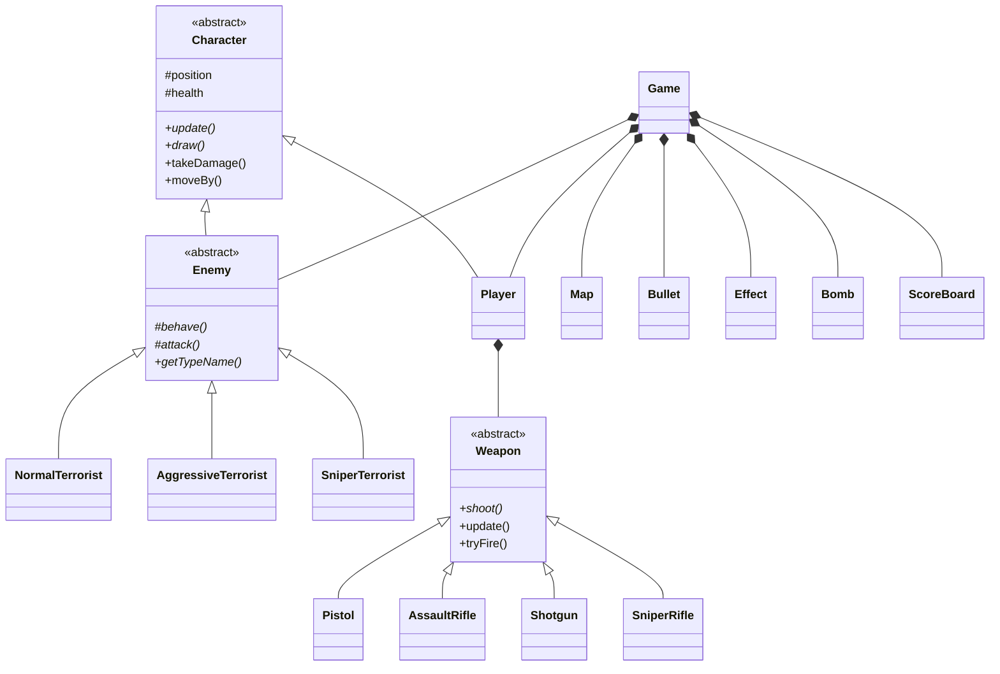

# Top-Down Strike

Top-Down Strike is a top-down tactical shooter written in C++11 using the [raylib](https://www.raylib.com) graphics library. The player assumes the role of a lone Counter-Terrorist defending two bomb sites, A and B, against successive waves of computer-controlled terrorists. In each round, one terrorist attempts to plant a bomb at a designated site while the others defend it. The player must eliminate the enemy squad or defuse the bomb before it detonates. Surviving five rounds completes the game.

The project was developed as an Object-Oriented Programming lab assignment. Beyond being a playable game, the codebase serves as a worked example of inheritance, runtime polymorphism, abstraction, encapsulation and composition in modern C++.

## Table of Contents

- [Features](#features)
- [Getting Started](#getting-started)
- [Controls](#controls)
- [How a Round Works](#how-a-round-works)
- [Enemies](#enemies)
- [Weapons](#weapons)
- [Project Structure](#project-structure)
- [Architecture](#architecture)
- [Troubleshooting](#troubleshooting)
- [License](#license)

---

## Features

- **Five escalating rounds.** Each round adds one more terrorist and scales their health, damage, speed, fire rate and accuracy.
- **Four weapons** with distinct behaviour: a pistol, an automatic rifle with recoil, a shotgun that fires eight pellets, and a sniper rifle that kills most enemies in one hit.
- **Three enemy types** (Terrorist, Rusher, Sniper) that share one AI skeleton but move and shoot differently.
- **A complete bomb mechanic.** A terrorist walks to the target site and plants the C4 (3 s). The bomb explodes 40 s later unless the player holds **E** for 5 s to defuse it.
- **Line of sight.** Enemies see the player only when nothing obstructs the view, and the player sees them only when they are in view.
- **Persistent high score** saved to `highscore.txt`, with exception handling around every file operation.
- **HUD and minimap**, a camera that follows the player, and keyboard- or mouse-driven menus (main, pause, round won, game over and victory).
- **No global variables and no manual `delete`.** Ownership is handled with `std::unique_ptr` and RAII.

---

## Getting Started

### Requirements

- A C++11 compiler (MinGW-w64 / w64devkit on Windows, `g++` or `clang++` elsewhere)
- [raylib](https://www.raylib.com) **4.0 or newer** (the code uses `MOUSE_BUTTON_LEFT`)
- The compiler and the raylib build must match: both 64-bit or both 32-bit

### Windows (recommended route)

1. Install raylib with the [official installer](https://www.raylib.com). It bundles raylib, the w64devkit compiler and Notepad++.
2. Clone the repository and open a terminal in the project folder:

```bash
git clone https://github.com/<your-username>/top-down-strike.git
cd top-down-strike
```

3. Build:

```bash
g++ main.cpp Game.cpp Character.cpp Player.cpp Enemy.cpp Weapon.cpp Bullet.cpp Bomb.cpp Map.cpp ScoreBoard.cpp -o top-down-strike.exe -std=c++11 -O2 -lraylib -lopengl32 -lgdi32 -lwinmm
```

4. Run `top-down-strike.exe`.

> **Note:** `ScoreBoard.cpp` must be included in the build command. Omitting it produces linker errors for `ScoreBoard::load`, `ScoreBoard::save` and related functions.

### VS Code

The repository includes a `.vscode` folder. Open the project folder in VS Code and press **F5**. The `build top-down-strike (debug)` task compiles all sources and launches the game under GDB. A second task, `build top-down-strike (release)`, produces an optimised build.

If raylib is not on the compiler's default search path, uncomment the `-I` and `-L` lines in `.vscode/tasks.json` and point them at the raylib `src` folder.

### Linux and macOS

raylib is not bundled with this repository. Install it first, either through a package manager or from source, and then build:

```bash
# Linux
g++ main.cpp Game.cpp Character.cpp Player.cpp Enemy.cpp Weapon.cpp Bullet.cpp Bomb.cpp Map.cpp ScoreBoard.cpp \
    -o top-down-strike -std=c++11 -O2 -lraylib -lGL -lm -lpthread -ldl -lrt -lX11

# macOS
g++ main.cpp Game.cpp Character.cpp Player.cpp Enemy.cpp Weapon.cpp Bullet.cpp Bomb.cpp Map.cpp ScoreBoard.cpp \
    -o top-down-strike -std=c++11 -O2 -lraylib -framework OpenGL -framework Cocoa -framework IOKit -framework CoreVideo
```

The project was developed and tested on Windows. The Linux and macOS commands are provided as a starting point and may need adjustment for your environment.

### Dev-C++

1. Copy `raylib.h` into `<Dev-Cpp>\MinGW64\include` and `libraylib.a` into `<Dev-Cpp>\MinGW64\lib`, using the folder that matches your compiler's bitness.
2. Create a Console Application C++ project and add **all** `.cpp` files.
3. Under *Project Options > Parameters*, set the C++ compiler flag to `-std=c++11` and the linker flags to `-lraylib -lopengl32 -lgdi32 -lwinmm`.
4. Select *Execute > Rebuild All*, then *Execute > Run*.

---

## Controls

| Input | Action |
|---|---|
| **W A S D** | Move |
| **Mouse** | Aim |
| **Left click** | Shoot (hold for the automatic rifle) |
| **R** | Reload (an empty magazine reloads automatically) |
| **1 2 3 4** or **mouse wheel** | Select Pistol / Assault Rifle / Shotgun / Sniper Rifle |
| **E** (hold) | Defuse the bomb. Stand inside the red circle; movement and shooting are disabled while defusing |
| **P** or **Esc** | Pause menu |
| **Up / Down + Enter**, or the mouse | Navigate menus |

---

## How a Round Works

1. The HUD announces which site the terrorists are heading for.
2. One terrorist, marked **C4**, walks to that site and plants the bomb. If he is killed, the nearest terrorist takes over.
3. Once planted, the bomb explodes in **40 seconds**. The remaining terrorists guard it.
4. Stand next to the bomb and hold **E** for **5 seconds** to defuse it. Releasing the key resets the progress.

The player **wins** the round by killing every terrorist before the bomb is planted, or by defusing the bomb. The player **loses** if killed or if the bomb explodes.

Health and ammunition reset at the start of every round. Round *N* spawns *N* + 2 terrorists (three in round 1, seven in round 5). Surviving round 5 displays the victory screen.

### Scoring

| Event | Points |
|---|---|
| Kill a terrorist | 10 |
| Win a round | 100 multiplied by the round number |

The best score is written to `highscore.txt` in the working directory and displayed in the main menu and the HUD.

---

## Enemies

| Type | Colour | Behaviour |
|---|---|---|
| **Terrorist** | Red | Medium health. Walks towards the player, then strafes sideways while firing steadily. |
| **Rusher** | Orange | Fast and aggressive. Closes to point-blank range and fires every 0.28 s (base rate) for low damage. |
| **Sniper** | Purple | Fragile. Backs away to keep its distance and fires slow, heavy bullets. A **red laser line** warns the player just before it shoots. |

All three share one AI routine (detect, move, attack) defined once in `Enemy::update()`. Only the parts that differ, `behave()` and `attack()`, are overridden per type.

---

## Weapons

| Weapon | Key | Damage | Fire interval | Magazine | Reload | Notes |
|---|:-:|---|---|---|---|---|
| Pistol | 1 | 22 | 0.30 s | 12 | 1.2 s | Accurate, semi-automatic |
| Assault Rifle | 2 | 14 | 0.10 s | 30 | 2.0 s | Automatic; recoil makes sustained fire less accurate |
| Shotgun | 3 | 13 x 8 pellets | 0.85 s | 6 | 2.2 s | Wide spread, short range |
| Sniper Rifle | 4 | 100 | 1.40 s | 5 | 2.8 s | Very fast bullet; one hit kills most enemies |

---

## Project Structure

```
top-down-strike/
├── main.cpp            Creates a Game and calls run()
├── Game.h / .cpp       Main loop, state machine, rounds, HUD, menus (owns everything)
├── Character.h / .cpp  ABSTRACT base class: position, health, movement, wall collision
├── Player.h / .cpp     Player : Character (keyboard + mouse, owns the weapons)
├── Enemy.h / .cpp      ABSTRACT Enemy : Character, plus Normal / Aggressive / Sniper terrorists
├── Weapon.h / .cpp     ABSTRACT Weapon, plus Pistol / AssaultRifle / Shotgun / SniperRifle
├── Bullet.h / .cpp     Bullet (projectile) and Effect (hit sparks)
├── Bomb.h / .cpp       C4: planting, countdown, defusing, explosion (state machine)
├── Map.h / .cpp        Walls, crates, bomb sites, spawns, collision and line of sight
├── ScoreBoard.h / .cpp Score, persistent high score, custom exception
├── Utils.h             Small inline math helpers (header-only)
├── .vscode/            Build, debug and IntelliSense configuration
└── .gitignore          Ignores *.exe, *.o and highscore.txt
```

---

## Architecture



In summary, `Game` owns a `Map`, a `Player`, a list of `Enemy` objects, the bullets, the effects, a `Bomb` and a `ScoreBoard`. The `Player` owns four `Weapon` objects, and everything that moves or shoots is reached through an abstract base class.

### Object-Oriented Design

| Concept | Application in this project |
|---|---|
| **Inheritance** | `Player` and `Enemy` extend `Character`; the three terrorist types extend `Enemy`; the four guns extend `Weapon`; `ScoreFileException` extends `std::runtime_error`. Shared logic is written once in the base class. |
| **Runtime polymorphism** | `Game` holds `std::vector<std::unique_ptr<Enemy>>` and calls `update()` and `draw()` through base pointers. `Player` holds `std::vector<std::unique_ptr<Weapon>>`, and `Weapon::tryFire()` invokes the virtual `shoot()`. |
| **Template Method pattern** | `Enemy::update()` defines the common AI sequence and delegates the type-specific steps to the virtual `behave()` and `attack()`. |
| **Abstraction** | `Character`, `Enemy` and `Weapon` are abstract classes with pure virtual functions. `Game` depends only on these interfaces. |
| **Encapsulation** | Data members are private or protected. State changes go through methods such as `takeDamage()`, `Weapon::tryFire()` and `Bomb::plant()` / `defuse()`, so each class enforces its own invariants. |
| **Composition** | `Game` owns every game object and `Player` owns its weapons. Lifetimes are managed by `std::unique_ptr`, which removes the need for manual `delete`. |
| **Operator and function overloading** | `ScoreBoard::operator+=`, a friend `operator<<`, overloaded `addPoints()` and overloaded constructors. |
| **Static members and friend functions** | `ScoreBoard::gamesPlayed` is a shared static counter; the friend `operator<<` prints the full scoreboard. |
| **File handling and exceptions** | `ScoreBoard::load()` and `save()` throw `ScoreFileException`, which `Game` catches so a missing or corrupt score file never stops the game. |

### Implementation Notes

- Bullets use a swept hit test, so fast projectiles cannot skip past an enemy between frames.
- Line of sight is computed with segment-versus-rectangle tests against walls and crates.
- The window is fixed at 1280 x 720 and runs at 60 FPS. The map is a 40 x 30 grid of 40-pixel tiles.
- The code uses C++11 features throughout: `std::unique_ptr`, `override`, `enum class` and lambdas.

---

## Troubleshooting

| Problem | Likely cause and fix |
|---|---|
| `cannot find -lraylib` | `libraylib.a` is not in your compiler's `lib` folder. Copy it there or add `-L<path>`. |
| `raylib.h: No such file or directory` | `raylib.h` is not in your compiler's `include` folder. Copy it or add `-I<path>`. |
| 32-bit / 64-bit mismatch errors | Download the raylib build that matches your compiler. |
| `MOUSE_BUTTON_LEFT was not declared` | Your raylib is older than 4.0. Update it. |
| `undefined reference to ScoreBoard::...` | `ScoreBoard.cpp` is missing from the build command. |
| "No saved high score found" in the console | Normal on first run. `highscore.txt` is created when you set your first record. |

---

## License

No license has been specified for this project. Add a `LICENSE` file and update this section to state the terms under which the code may be used.